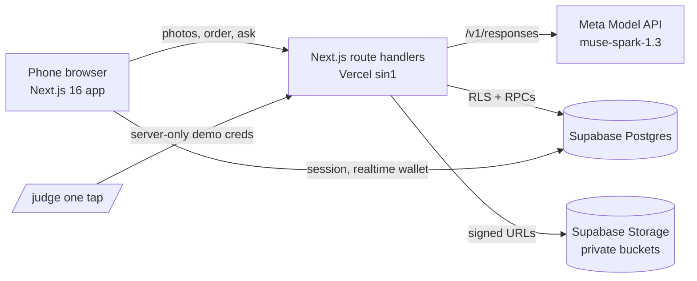

# Prox Now

**Live:** https://prox-now.vercel.app · **Judges:** https://prox-now.vercel.app/judge ([JUDGES.md](JUDGES.md)) · **Video:** TODO (captain adds link)

Prox Now makes a street's small shops readable and orderable in any language. A shopper snaps a shop's sign or menu. Meta's `muse-spark-1.3` turns the photos into the shop's **book**, with one page per real category, items, and prices only when they're readable. The shopper asks the map what's good right now, builds an order, and shows staff a translated order screen. The owner claims the shop and thanks the people who snapped it or built its book with a coupon, and the shopper scratches it in their wallet.

Built for one street we know first-hand: Soi 102, Hua Hin, Thailand. Tourists can't read the Thai menus, and the tiny shops have no website or English menu.

Indie track, theme "Build for Your World". Built during the Meta Global AI Developer Hackathon (Oct 26 to Nov 4, 2026). See [docs/PROVENANCE.md](docs/PROVENANCE.md).

The demo café photos are real photos taken by the founder, not AI-generated.

The shop in the demo video is a real all-Thai shop in Hua Hin, built live with Prox Now. The owner asked not to be filmed.

## Submitted build
| | |
|---|---|
| Live app | https://prox-now.vercel.app |
| Branch and commit | `feat/judge-mode`, `70d5f87` |
| Production deployment | `dpl_J7jUhsJs6hHgLjtduQFtPdkrMVoL` |
| Tests | 544 tests, 119 files |
| Demo video | TODO |

## Try it in 3 minutes
Open https://prox-now.vercel.app/judge. The buttons sign you in with one tap as one of two shared demo accounts. You need no password, camera, location or phone. Do **Judge 1 (shopper) first, then Judge 2 (owner)**, one after the other. Full steps and what each one proves are in [JUDGES.md](JUDGES.md).

## Meta models used
Every AI call in the app goes to **`muse-spark-1.3`** on the Meta Model API (`https://api.meta.ai/v1/responses`). No other AI provider is used. The shared client is `lib/ai/meta.ts` (`callSpark`, `callSparkImages`, 25 s timeout).

| Feature | What the model does | Files |
|---|---|---|
| Book building | Reads up to 8 photos per call (chunked) into pages by real category, with items, readable prices and the shop's language | `app/api/book/pages/route.ts`, `lib/book/read.ts`, `lib/book/chunk.ts` |
| Book improve / brand | Adds a new photo to an existing book; reads brand cues from the storefront | `lib/book/improve.ts`, `lib/book/brand.ts` |
| Seed coach | Per photo: what's in it, whether it's a duplicate or blurry | `app/api/seed/check/route.ts` |
| Shop match | Matches a snapped photo to a nearby shop using GPS and the sign text | `app/api/analyze/route.ts` |
| New shop from a sign | Creates a shop from the sign it reads (confidence ≥ 0.6, distance rules) | `app/api/shops/route.ts` |
| Posts: faces and place facts | Marks face boxes so the server can blur them; reads items, prices, crowd level, open/closed and sign language | `app/api/posts/route.ts` |
| Ask the map | "What's good right now" over open shops | `lib/gonow/spark.ts`, `app/api/go-now/route.ts` |
| Order translation | Translates menu item names and the shopper's note into the shop's language for staff | `lib/order/translate.ts`, `app/api/order/translate/route.ts` |
| Claim check | Checks a real shop's claim photo (handwritten code next to the sign) | `app/api/owner/claim/route.ts` |
| Coupon suggestion | Suggests a thank-you offer for the owner | `lib/coupon/suggest.ts`, `app/api/owner/suggest-coupon/route.ts` |
| Proof call | One server-side call that shows the key works | `app/api/meta-ping/route.ts` |

## How it maps to the judging criteria
| Criterion | Evidence |
|---|---|
| Impact | Real pilot street, real shop photos in the demo; tourists and shops with no English menu; places people add are exported as public GeoJSON (`app/api/places/export/route.ts`) |
| Use of Meta AI | 11 features on `muse-spark-1.3`, including multi-image book reading, vision-based face blur, claim-photo checks and translation (table above) |
| Demo | One-tap `/judge`, a 9-step guided tour with an explainer on every step (`lib/judge/script.ts`, `components/judge/TourChrome.tsx`), pre-seeded real photos so no camera is needed, and End demo resets (`lib/judge/runReset.ts`) |
| Technical depth | Postgres row-level security and security-definer RPCs (`supabase/migrations/`, 23 files), shared rate limits in the DB (`lib/rate/window.ts`, `0010_rate_limits.sql`), private photo buckets served with signed URLs (`0021_private_photos.sql`, `app/api/media/`), server-side face blur, and 544 unit tests in 119 files |

## Architecture


## Privacy rules in the code
- Faces are blurred on the server before anything is saved. The original photo is never stored, and EXIF/GPS is stripped. A person can unblur only their own face.
- The model never identifies people and never describes their appearance beyond crowd level.
- The owner chooses Keep or Pass. Pass deletes the blurred photo for good.

## Run it locally
```bash
npm install
cp .env.example .env.local   # fill in values on your machine; never commit it
npm run dev                  # http://localhost:3000
npm test                     # vitest: 119 files, 544 tests
npm run build
```
`.env.example` (names only):
```
META_API_KEY=
NEXT_PUBLIC_SUPABASE_URL=
NEXT_PUBLIC_SUPABASE_ANON_KEY=
SUPABASE_SERVICE_ROLE_KEY=
DEMO_EXPLORER_EMAIL=
DEMO_EXPLORER_PASSWORD=
DEMO_OWNER_EMAIL=
DEMO_OWNER_PASSWORD=
```
Without `META_API_KEY`, the AI routes return `ai_not_configured` ("The shop reader is offline"). Without the `DEMO_*` values, `/judge` shows "Demo sign-in is not ready yet." Those values stay on the server and are never sent to the browser (`lib/judge/demo.ts`).

## Known limits
- One pilot street. Prices appear only when the model can read them.
- The demo uses two shared accounts. Judges running at the same time share one demo state.
- Demo shops skip the claim code; a real shop needs the code photo.
- A book takes about 30 seconds to build.

## More
Design: [docs/design/DESIGN.md](docs/design/DESIGN.md) · Build notes: `docs/build/` · Provenance: [docs/PROVENANCE.md](docs/PROVENANCE.md)

## License
MIT © 2026 PLOT TWIST LLC. See [LICENSE](LICENSE).
