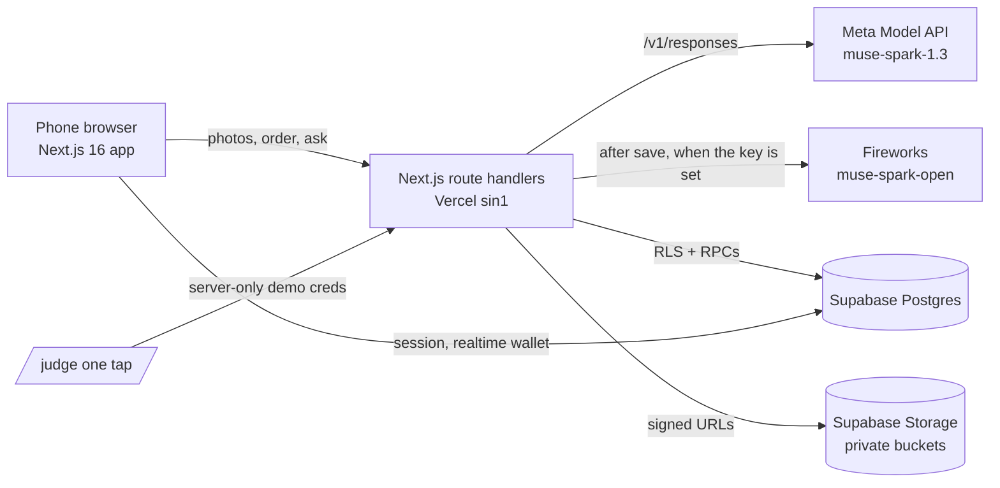

# Prox Now

**Live:** https://prox-now.vercel.app · **Judges:** https://prox-now.vercel.app/judge ([JUDGES.md](JUDGES.md)) · **Video:** [3-minute demo](https://youtube.com/shorts/_fUl4ZByer4)

Prox Now makes a street's small shops readable and orderable in any language. A shopper snaps a shop's sign or menu. Meta's `muse-spark-1.3` turns the photos into the shop's **book**, with one page per real category, items, and prices only when they're readable. The shopper asks the map what's good right now, builds an order, and shows staff a translated order screen. The owner claims the shop and thanks the people who snapped it or built its book with a coupon, and the shopper scratches it in their wallet.

Built for one street we know first-hand: Soi 102, Hua Hin, Thailand. Tourists can't read the Thai menus, and the tiny shops have no website or English menu.

Indie track, theme "Build for Your World". Built during the Meta Global AI Developer Hackathon (Oct 26 to Nov 4, 2026). See [docs/PROVENANCE.md](docs/PROVENANCE.md).

The demo café photos are real photos taken by the founder, not AI-generated.

The shop in the demo video is a real all-Thai shop in Hua Hin, built live with Prox Now. The owner asked not to be filmed.

## Submitted build
| | |
|---|---|
| Live app | https://prox-now.vercel.app |
| Branch and commit | `main` (same as `feat/judge-mode`), app code `71d312b` |
| Production deployment | `main` auto-deploys to https://prox-now.vercel.app |
| Tests | 571 tests, 122 files |
| Demo video | https://youtube.com/shorts/_fUl4ZByer4 |

## Try it in 3 minutes
Open https://prox-now.vercel.app/judge. The buttons sign you in with one tap as one of two shared demo accounts. You need no password, camera, location or phone. Do **Judge 1 (shopper) first, then Judge 2 (owner)**, one after the other. Full steps and what each one proves are in [JUDGES.md](JUDGES.md).

## Meta models used
Most Spark calls go through `lib/ai/meta.ts` (`callSpark`, `callSparkImages`, 25 s timeout) to **`muse-spark-1.3`** on the Meta Model API (`https://api.meta.ai/v1/responses`). `lib/gonow/spark.ts`, `lib/order/translate.ts`, and `app/api/meta-ping/route.ts` are direct calls to that same endpoint.

After the book is saved, `lib/ai/openCheck.ts` checks each page on its own, up to 4 pages at once, against Meta **`muse-spark-open`** on Fireworks (`accounts/fireworks/models/muse-spark-open`) when `FIREWORKS_API_KEY` is set. Each call sends that page's item names and its photo, downscaled to 1024 px. The checks run in `after()` with a 30 s timeout each and do not delay the save. No key, a timeout, a non-200, or bad JSON fails open for that page and the book still posts every Spark item. An item is flagged "check this" only when its own page's check says unconfirmed. On the next load, once a verdict exists, the book shows "Double-checked by Muse Spark Open".

| Feature | Model | File |
|---|---|---|
| Book building | `muse-spark-1.3` | `lib/book/read.ts` via `app/api/book/pages/route.ts` |
| Book improve | `muse-spark-1.3` | `lib/book/improve.ts` |
| Book brand | `muse-spark-1.3` | `lib/book/brand.ts` |
| Seed coach | `muse-spark-1.3` | `app/api/seed/check/route.ts` |
| Shop match | `muse-spark-1.3` | `app/api/analyze/route.ts` |
| New shop from a sign | `muse-spark-1.3` | `app/api/shops/route.ts` |
| Post faces and place facts | `muse-spark-1.3` | `app/api/posts/route.ts` |
| Ask the map | `muse-spark-1.3` | `lib/gonow/spark.ts` (direct call) via `app/api/go-now/route.ts` |
| Order translation | `muse-spark-1.3` | `lib/order/translate.ts` (direct call) via `app/api/order/translate/route.ts` |
| Claim check | `muse-spark-1.3` | `app/api/owner/claim/route.ts` |
| Coupon suggestion | `muse-spark-1.3` | `lib/coupon/suggest.ts` via `app/api/owner/suggest-coupon/route.ts` |
| Proof call | `muse-spark-1.3` | `app/api/meta-ping/route.ts` (direct call) |
| Book item double-check | `accounts/fireworks/models/muse-spark-open` | `lib/ai/openCheck.ts` (after the book is saved) |

## For judges
| Criterion | Where to see it |
|---|---|
| Impact (30) | A real Hua Hin street. Shoppers snap a menu and get a book they can order from (`app/(app)/book/[slug]/page.tsx`). Owners thank them with a coupon (`JUDGES.md`). Added places export as GeoJSON (`app/api/places/export/route.ts`). |
| Meta AI (25) | Every runtime call is in the model map above. Most Spark calls go through `lib/ai/meta.ts`. `lib/gonow/spark.ts`, `lib/order/translate.ts`, and `app/api/meta-ping/route.ts` call the same endpoint directly. `muse-spark-open` double-checks book items after the save when `FIREWORKS_API_KEY` is set (`lib/ai/openCheck.ts`). |
| Demo (25) | One tap at `/judge`. Nine tour steps with an explainer each (`lib/judge/script.ts`, `components/judge/TourChrome.tsx`). Sample photos, no camera. The map opens fitted to the demo shops. End demo resets (`lib/judge/runReset.ts`). Steps: [JUDGES.md](JUDGES.md). |
| Depth (20) | Postgres RLS and security-definer RPCs (`supabase/migrations/`, 24 files through 0024; 0025 and 0026 are files only until apply), shared rate limits (`lib/rate/window.ts`, `0010_rate_limits.sql`), private photos with signed URLs (`0021_private_photos.sql`, `app/api/media/`), server-side face blur, and 571 unit tests in 122 files |

## Architecture


## Privacy rules in the code
- Faces are blurred on the server before anything is saved. The original photo is never stored, and EXIF/GPS is stripped. A person can unblur only their own face.
- The model never identifies people and never describes their appearance beyond crowd level.
- The owner chooses Keep or Pass. Pass deletes the blurred photo for good.

## Run it locally
```bash
npm install
cp .env.example .env.local   # fill in values on your machine; never commit it
npm run dev                  # http://localhost:3000
npm test                     # vitest: 122 files, 571 tests
npm run build
```
`.env.example` (names only):
```
META_API_KEY=
FIREWORKS_API_KEY=
NEXT_PUBLIC_SUPABASE_URL=
NEXT_PUBLIC_SUPABASE_ANON_KEY=
SUPABASE_SERVICE_ROLE_KEY=
DEMO_EXPLORER_EMAIL=
DEMO_EXPLORER_PASSWORD=
DEMO_OWNER_EMAIL=
DEMO_OWNER_PASSWORD=
```
Without `META_API_KEY`, the AI routes return `ai_not_configured` ("The shop reader is offline"). Without the `DEMO_*` values, `/judge` shows "Demo sign-in is not ready yet." Those values stay on the server and are never sent to the browser (`lib/judge/demo.ts`).

## Known limits
- One pilot street. Prices appear only when the model can read them.
- The demo uses two shared accounts. Judges running at the same time share one demo state.
- Demo shops skip the claim code; a real shop needs the code photo.
- A book takes about 30 seconds to build.

## More
Design: [docs/design/DESIGN.md](docs/design/DESIGN.md) · Build notes: `docs/build/` · Provenance: [docs/PROVENANCE.md](docs/PROVENANCE.md)

## License
MIT © 2026 PLOT TWIST LLC. See [LICENSE](LICENSE).
